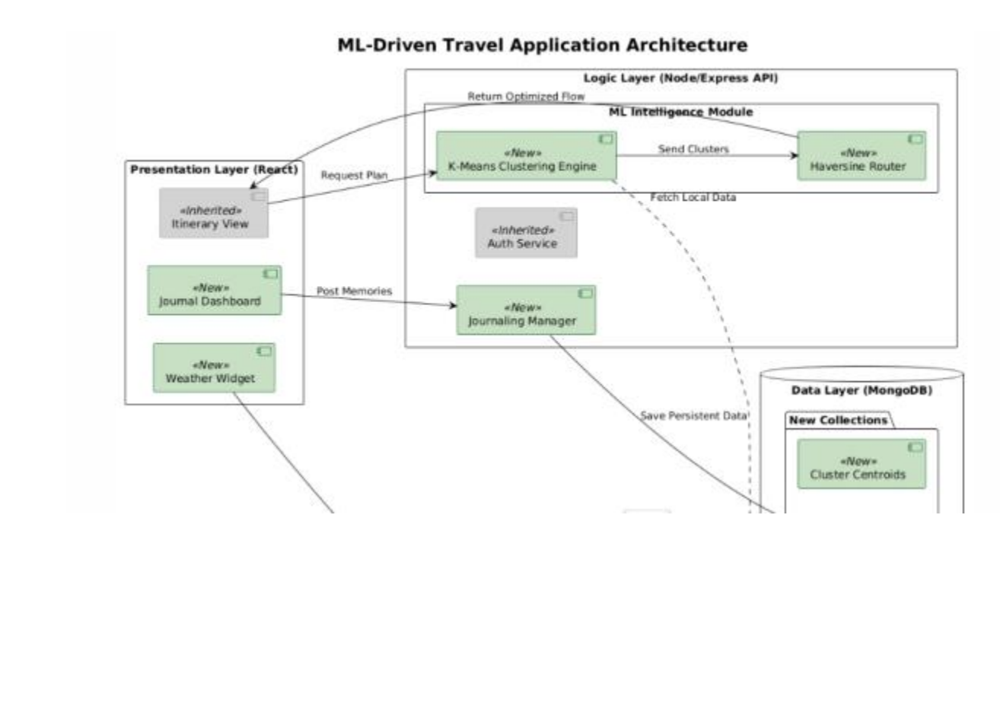
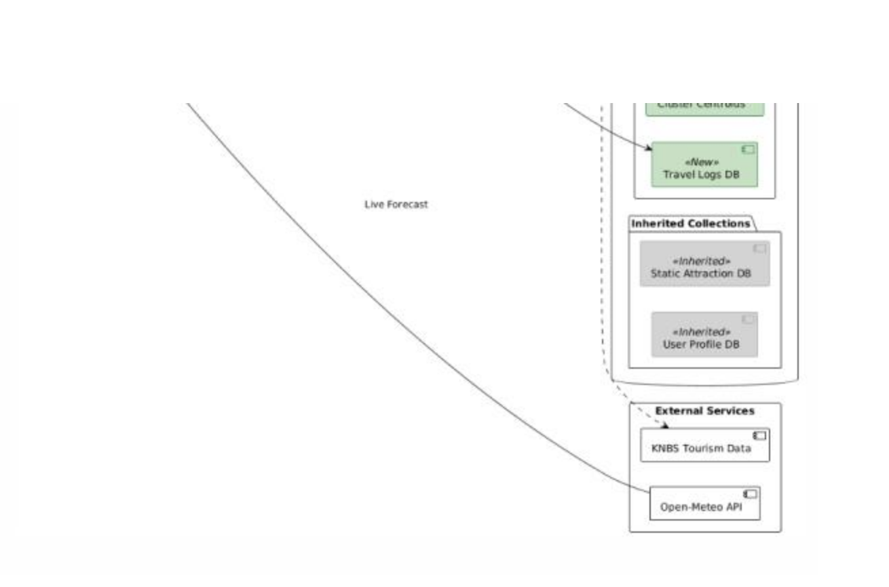
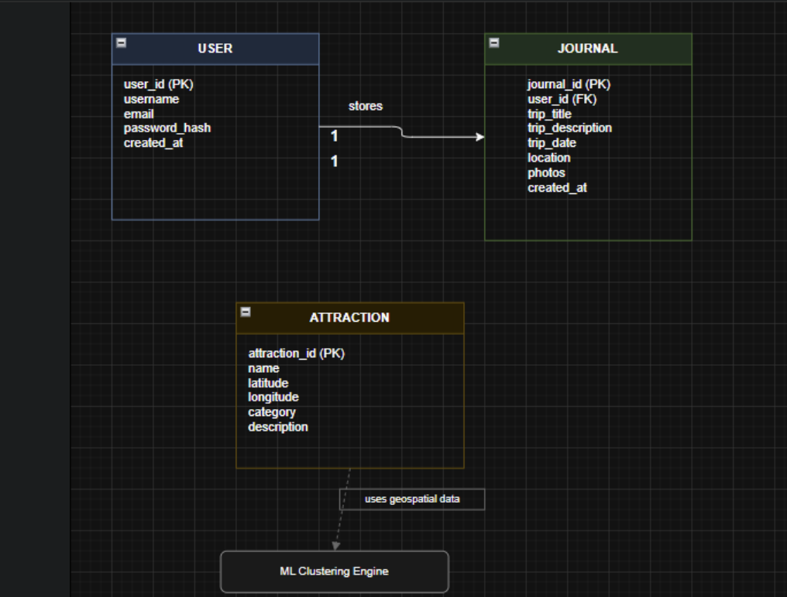
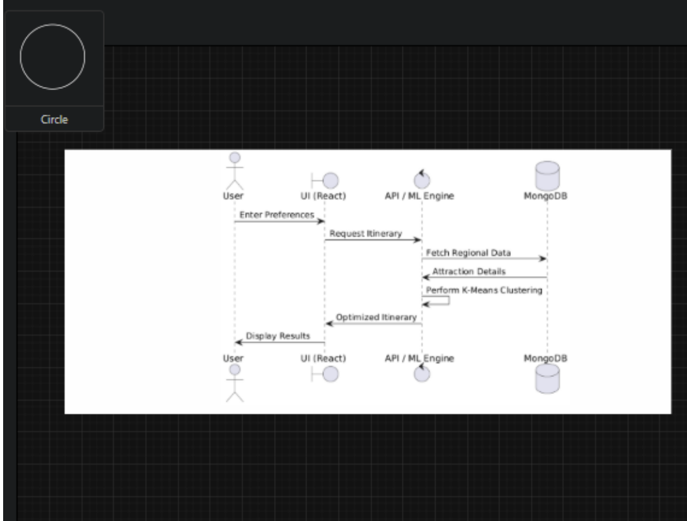
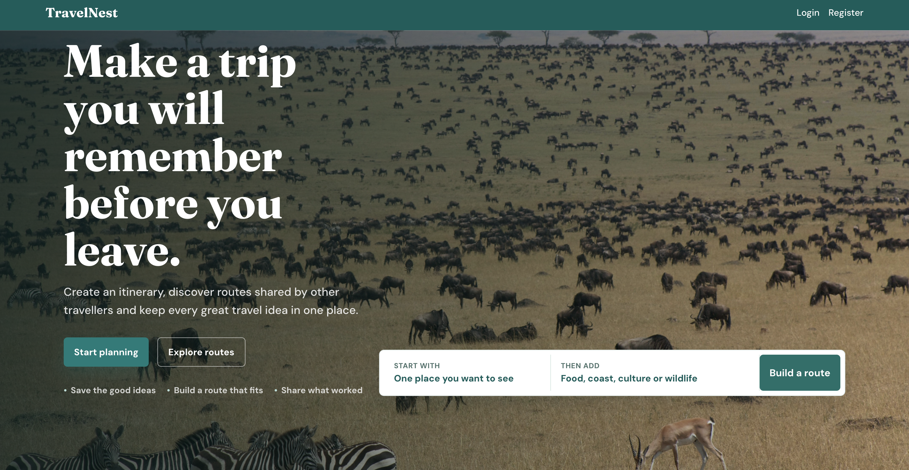
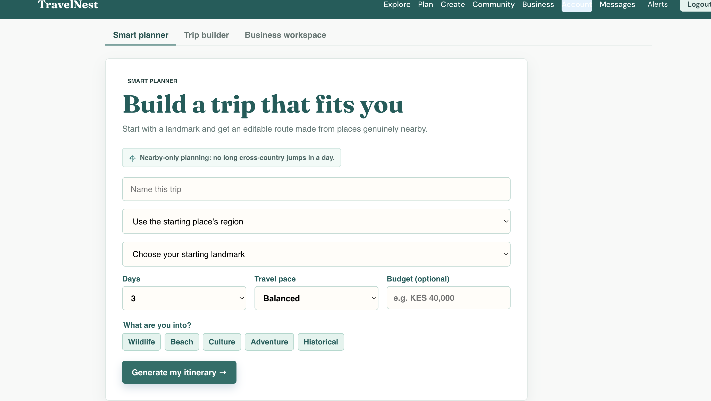
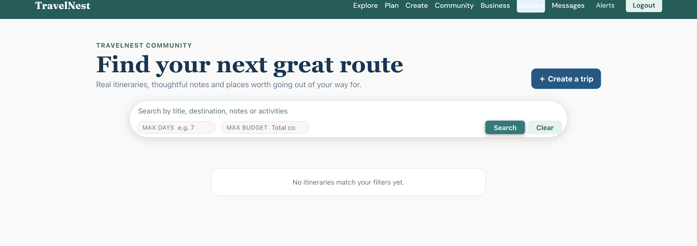

# TravelNest

TravelNest is a full-stack travel-planning and community platform built around Kenyan travel. Travellers can discover places, build and share itineraries, connect with other travellers, and manage their travel profile. Businesses can submit listings for review, while administrators moderate community and marketplace content.

> This repository documents the platform architecture and local development workflow. Deployment URLs and environment-specific identifiers are intentionally excluded.

## What TravelNest delivers

- Plan, save, edit, and share multi-stop travel itineraries
- Generate trip suggestions with the Smart Planner, using starting point, region, interests, and travel pace
- Explore Kenyan destinations across Coast, Nairobi, Rift Valley, Central, Western, and Southern Safari regions
- Participate in a travel community through profiles, follows, messages, likes, saves, comments, and notifications
- Let verified businesses submit travel listings through the SME Portal
- Support administrator review of business access, listings, and traveller-suggested places
- Protect accounts with JWT authentication, email verification, and password-reset flows

## Architecture at a glance

TravelNest uses a React single-page application backed by a Node.js and Express REST API. The API owns authentication, itinerary planning, community features, moderation workflows, uploads, and email delivery; MongoDB stores the application data.

| Layer | Responsibility | Deployment |
| --- | --- | --- |
| React frontend | Responsive traveller, business, and admin experience | Vercel |
| Express API | REST endpoints, application rules, authentication, uploads, and integrations | Render |
| MongoDB + Mongoose | Persistent data for users, places, itineraries, conversations, and notifications | MongoDB Atlas in production |
| SMTP provider | Verification and password-reset email delivery | Configured through environment variables |

The architecture diagram is shown in two consecutive parts below; together they form one complete view of the system.





## Domain model

The core data model centres on travellers and the trips they create. Itineraries organise attractions and travel plans; community capabilities are supported by user profiles, conversations, messages, notifications, and place suggestions.



## Journey documentation

The sequence diagram documents the main application journey and the collaboration between the client, API, authentication layer, and database while a user works with TravelNest.



## Product preview

| Home | Itinerary builder |
| --- | --- |
|  |  |



## API design

The backend exposes RESTful endpoints under `/api` and returns JSON responses. Key resources include:

| Resource | Base path | Purpose |
| --- | --- | --- |
| Authentication | `/api/auth` | Registration, sign-in, verification, and password recovery |
| Itineraries | `/api/itineraries` | Create, read, update, delete, and share trip plans |
| Smart Planner | `/api/smart-planner` | Build itinerary suggestions from trip preferences |
| Attractions | `/api/attractions` | Browse travel places and supporting destination data |
| Users | `/api/users` | Profiles and community interactions |
| Chat | `/api/chat` | Conversations and traveller messaging |
| Notifications | `/api/notifications` | User notification retrieval and management |

Protected routes use JWT bearer tokens. Passwords are hashed with bcrypt before they are stored.

## Technology

- **Frontend:** React, React Router, Axios, and Create React App
- **Backend:** Node.js, Express, Mongoose, and MongoDB
- **Authentication:** JSON Web Tokens (JWT) and bcrypt
- **Uploads:** Multer with publicly served upload paths
- **Email:** Nodemailer over SMTP
- **Deployment:** Vercel for the frontend and Render for the API

## Local setup

### 1. Install dependencies

```bash
cd backend
npm install

cd ../frontendd
npm install
```

### 2. Configure environment variables

Copy the example environment file:

```bash
cd backend
cp .env.example .env
```

Set at least the following in `backend/.env`:

```env
MONGO_URI=mongodb://127.0.0.1:27017/travelnest
JWT_SECRET=replace-with-a-long-random-secret
PORT=3001
CLIENT_URL=http://localhost:3000
```

### 3. Start MongoDB locally

On macOS with Homebrew:

```bash
brew services start mongodb-community@8.0
```

### 4. Start the application

Run the API and frontend in separate terminals:

```bash
cd backend
npm run dev
```

```bash
cd frontendd
npm start
```

The frontend runs at `http://localhost:3000`; the API runs at `http://localhost:3001`.

## Seed Kenyan travel places

To add the starter set of attractions to an empty database:

```bash
cd backend
npm run seed
```

> Warning: this command replaces the existing attraction collection.

## Email configuration

Email verification and reset delivery are disabled by default for demos. Set `REQUIRE_EMAIL_VERIFICATION=true` and `DIRECT_PASSWORD_RESET=false` when ready to enable the SMTP flow.

```env
SMTP_HOST=smtp.gmail.com
SMTP_PORT=587
SMTP_SECURE=false
SMTP_USER=your-gmail@gmail.com
SMTP_PASS=your-gmail-app-password
MAIL_FROM="TravelNest <your-gmail@gmail.com>"
```

For Gmail, use an App Password rather than your normal account password. When SMTP is not configured, development links are returned in the UI and written to the backend console.

## Roles and moderation

| Role | Access |
| --- | --- |
| `traveller` | Plans trips, explores places, and participates in the community |
| `business` | Requests verified access and submits travel listings |
| `admin` | Reviews business access, listings, and traveller suggestions |

To make an existing local user an administrator, run this in `mongosh`:

```javascript
use travelnest
db.users.updateOne(
  { email: "your-email@example.com" },
  { $set: { role: "admin" } }
)
```

## Deployment

1. Create a MongoDB Atlas database and set its connection string as `MONGO_URI` in Render.
2. Create a Render Web Service with `backend` as the root directory, `npm ci` as the build command, and `npm start` as the start command. Set `CLIENT_URL` to your production frontend domain.
3. Create a Vercel project with `frontendd` as its root directory. Set `REACT_APP_API_URL` to your production API URL and redeploy.
4. Before public registration, configure SMTP values and restrict CORS to approved frontend origins. For preview deployments, use comma-separated origins in `CLIENT_URL`.

For a clear distinction between development conveniences and production requirements, read [Production readiness](docs/PRODUCTION-READINESS.md).

## Project structure

```text
travelnestapp/
├── backend/           # Express API, MongoDB models, auth, planner, and integrations
├── frontendd/         # React user interface
├── docs/screenshots/  # Architecture, UML, sequence, and product visuals
└── README.md
```
